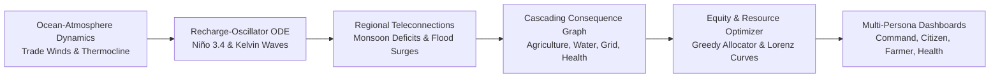

# 🌍 CLIMA-SHIELD | 3D ENSO Climate Simulator & Community Resilience Decision Engine

<div align="center">

[](https://opensource.org/licenses/MIT)
[](https://react.dev/)
[](https://www.typescriptlang.org/)
[](https://threejs.org/)
[](https://fastapi.tiangolo.com/)
[](https://www.python.org/)
[](https://vitejs.dev/)
[](https://tailwindcss.com/)

**From Planetary Climate Signals to Hyper-Local Community Action.**  
An end-to-end, scientifically-rigorous 3D simulation platform and climate resilience decision engine linking Pacific ocean-atmospheric coupled dynamics (El Niño-Southern Oscillation) to cascading socioeconomic impacts across India and Southeast Asia.

[Key Features](#-key-features) • [Architecture](#-system-architecture) • [Physical Models](#-physical--mathematical-formulation) • [Dashboards](#-dashboard-ecosystem) • [Quickstart](#-quickstart-guide) • [API Reference](#-api-endpoints)

</div>

---

## 📖 Executive Summary

The **El Niño–Southern Oscillation (ENSO)** is Earth's most powerful interannual climate driver, dictating monsoon failures, extreme thermal anomalies, and agricultural shockwaves thousands of kilometers away. Yet conventional climate tools remain trapped in isolated silos: oceanographers view Kelvin wave isotherms in 3D, while disaster management teams rely on static, fragmented 2D maps without socioeconomic sensitivity weighting.

**CLIMA-SHIELD** bridges this divide. It pairs a **deterministic coupled ocean-atmosphere numerical simulator** with an **equity-weighted socio-economic consequence engine** and a suite of **real-time operational command dashboards** tailored for government planners, healthcare systems, farmers, and frontline citizens.



---

## ✨ Key Features

### 1. 🌐 Scientifically-Grounded 3D ENSO Simulation
- **Coupled Physical Simulation**: Real-time numerical integration of the Recharge-Oscillator and Bjerknes positive feedback mechanism.
- **Dynamic 3D Shaders**: 128×64 displaced ocean vertex grid with custom Sea Surface Temperature (SST) divergence colormapping.
- **Subsurface Thermocline Tilt**: Visualizes the equatorial 20°C isotherm displacement and propagating eastward downwelling Kelvin wave packets.
- **3D Atmospheric Walker Cell**: Instanced equatorial wind vectors depicting trade wind relaxation, stalling, and westerly wind burst triggers.
- **Teleconnection Anomaly Columns**: 3D interactive regional rainfall pillars illustrating monsoon deficits in Central/Western India and flood spikes in Chennai/Southeast Asia.

### 2. ⚖️ Multidimensional Equity & Counterfactual Decision Engine
- **Vulnerability Weighting**: Combines poverty index, rain-fed crop dependence, irrigation deficits, informal housing fragility, and elderly demographics.
- **Lorenz Curve & Gini Metrics**: Dynamically calculates income and climate damage inequality ratios under business-as-usual vs. targeted intervention scenarios.
- **Counterfactual Budget Allocator**: Knapsack-style greedy resilience capital allocator distributing funding across micro-irrigation, drainage retrofits, shaded cooling corridors, and index insurance.
- **Monte Carlo Stability Verification**: 200× perturbation analysis validating intervention recommendations against chaotic meteorological forecast noise.

### 3. 🎯 Multi-Persona Operational Dashboards
- **Command Center**: Macro-level situational awareness, risk band classifications (`EXTREME`, `HIGH`, `MODERATE`), multi-hazard telemetry, and live alert dispatches.
- **Citizen Dashboard & Climate SOS**: Geolocation-aware emergency assistance, relief shelter locators, cooling point directories, and push evacuation advisories.
- **Farmer Agro-Intelligence**: Crop vulnerability index, soil moisture deficit predictions, sowing window adjustments, and drought mitigation guidance.
- **Healthcare Surge Monitor**: Heat-stress morbidity models, hospital hydration bed occupancy projections, and vector-borne outbreak early warning metrics.
- **Consequence Graph**: Multi-order cascading risk propagation graph tracing physical shocks to infrastructure and community failure modes.
- **Invisible Population Engine**: Identifies uncounted vulnerable populations (informal settlements, migrant workers, unbanked daily wage laborers) missed by traditional census grids.
- **Resilience Ledger**: Transparent audit ledger tracking municipal resilience investments and projected lives protected.

---

## 🏛 System Architecture

```
El-Nino/
├── 3d/                          # Dedicated 3D Three.js / R3F Simulation Engine
│   └── src/
│       ├── components/          # Canvas, Ocean shaders, Thermocline mesh, WindField
│       ├── simulation/          # Coupled ENSO ODEs, teleconnections, equity math
│       ├── store/               # Zustand simulation state store
│       └── ui/                  # Overlays, timeline scrubbers, camera controls
│
├── frontend/                    # Full-Stack Decision & Operational Platform
│   ├── public/                  # Static assets & brand media
│   └── src/
│       ├── assets/              # Icons and graphics
│       ├── components/          # Reusable UI primitives, TopBar, BrandLogo, Modals
│       ├── pages/               # 20+ Role-based dashboards & analytical pages
│       │   ├── CommandCenter.tsx         # Disaster headquarters dashboard
│       │   ├── CitizenDashboard.tsx      # Public citizen portal & shelter map
│       │   ├── FarmerDashboard.tsx       # Agronomic advisories & soil telemetry
│       │   ├── HealthcareDashboard.tsx   # Thermal stress & hospital surge monitor
│       │   ├── ConsequenceGraph.tsx      # Cascading system shock visualizer
│       │   ├── InvisiblePopulation.tsx   # Algorithmic blind-spot detector
│       │   ├── ResourceOptimizer.tsx     # Greedy budget allocation optimizer
│       │   ├── ResilienceLedger.tsx      # Adaptation audit ledger
│       │   ├── ScenarioLab.tsx           # Multi-scenario perturbation sandbox
│       │   ├── Vulnerability.tsx         # District vulnerability matrices
│       │   └── LandingPage.tsx           # Interactive entry portal
│       ├── services/            # API client layer & WebSocket feeds
│       ├── store/               # Global Zustand state management
│       └── types/               # TypeScript data definitions & API contracts
│
├── backend/                     # FastAPI Telemetry & Optimization Microservice
│   └── app/
│       ├── api/routes/          # REST endpoints (health, core, intelligence)
│       ├── core/                # App configuration, security, CORS
│       ├── schemas/             # Pydantic v2 data envelopes & validation schemas
│       ├── services/            # Intelligence services & NLP report classification
│       └── main.py              # Application entry point & Uvicorn runner
│
├── README.md                    # Project documentation
├── package.json                 # Root monorepo / 3D runner dependencies
└── run.txt                      # Backend execution shorthand
```

---

## 🔬 Physical & Mathematical Formulation

### 1. Coupled ENSO Recharge-Oscillator
The core oceanic-atmospheric coupling is governed by a modified Jin (1997) Recharge-Oscillator ODE system:

$$\frac{d(\text{Niño3.4})}{dt} = a \cdot W(t) + b \cdot h(t) + c \cdot (\text{Niño3.4}) - d \cdot (\text{Niño3.4})^3$$

$$\frac{dh(t)}{dt} = -e \cdot (\text{Niño3.4}) - f \cdot h(t)$$

Where:
- $\text{Niño3.4}$ is the central-eastern equatorial Pacific sea surface temperature anomaly ($^\circ\text{C}$).
- $h(t)$ represents the zonally averaged thermocline depth / equatorial Pacific warm water volume ($m$).
- $W(t)$ is anomalous equatorial wind stress (trade wind perturbation and westerly bursts).
- $a, b, c, d, e, f$ are empirically calibrated stability and non-linear damping coefficients (`src/simulation/config.js`).

### 2. Teleconnection Propagation Matrix
Equatorial SST anomalies project into regional precipitation anomalies ($\Delta P_i$) using seasonally-masked regression coefficients ($\beta_i$):

$$\Delta P_i(t) = \beta_i \cdot \text{Niño3.4}(t - \tau_i) + \epsilon_i$$

- **Central India / Mumbai**: Strong negative teleconnection ($\beta < 0$, severe SW monsoon rainfall deficit).
- **Southeast Coast / Chennai**: Positive teleconnection ($\beta > 0$, enhanced NE monsoon rainfall and cyclonic inundation).
- **Maritime Continent / SE Asia**: Strong drought and elevated wildfire hazard indices.

### 3. Socioeconomic Vulnerability & Gini Engine
Composite District Vulnerability Index ($V_i$) combines exposure, sensitivity, and lack of adaptive capacity:

$$V_i = w_p P_i + w_a A_i + w_w W_i + w_h H_i - w_c C_i$$

Where:
- $P_i$: Poverty headcount ratio
- $A_i$: Rain-fed agricultural dependency
- $W_i$: Water infrastructure deficit
- $H_i$: Informal / non-pucca housing ratio
- $C_i$: Coping / adaptive capacity

The **Resilience Optimizer** minimizes aggregate expected loss under budget constraint $B$:

$$\min \sum_{i} \Big( L_i(V_i) \cdot \prod_{k} (1 - \eta_k x_{ik}) \Big) \quad \text{s.t.} \quad \sum_{i, k} c_k x_{ik} \le B$$

---

## 🖥 Dashboard Ecosystem

| Dashboard | Target User | Key Capabilities |
| :--- | :--- | :--- |
| **Command Center** | Disaster Managers / District Collectors | Real-time multi-hazard radar, compound threat indexing, alert broadcasting, evacuation readiness tracking. |
| **Citizen Portal & SOS** | General Public & Frontline Residents | Emergency 1-tap SOS, offline cooling shelter routing, water supply alerts, personalized family safety checklists. |
| **Farmer Dashboard** | Agricultural Officers & Farmers | Monsoonal onset dates, localized soil water deficit, drought-tolerant crop advisories, contingency planting guidance. |
| **Healthcare Dashboard** | Chief Medical Officers & Hospital Admins | Thermal shock admission forecasting, ORS & hydration depot logistics, vector-borne epidemiology alerts. |
| **Consequence Graph** | Policy Analysts & Systems Planners | Interactive Directed Acyclic Graph (DAG) visualizing second- and third-order ripple impacts from power grids to transit. |
| **Invisible Population** | Social Welfare & NGO Coordinators | Machine-learning detection of uncounted vulnerable enclaves, migratory workers, and demographic blind spots. |
| **Resource Optimizer** | Budget Authorities | Algorithmic capital allocation engine with real-time ROI tracking in averted casualties and economic loss. |
| **Scenario Lab** | Climate Scientists & Risk Modelers | Interactive parameter tuning for Super El Niño, Strong La Niña, Modoki anomalies, and compound extreme events. |

---

## 🚀 Quickstart Guide

### Prerequisites
- **Node.js**: v18.0.0 or higher (`v20+` recommended)
- **Python**: v3.11 or higher
- **Package Manager**: `npm`, `yarn`, or `bun`

---

### Step 1: Clone the Repository
```bash
git clone https://github.com/Thanveer265/el-nino-.git
cd el-nino-
```

---

### Step 2: Run the Backend Microservice (FastAPI)

1. Open a new terminal in the project root:
   ```bash
   cd backend
   ```
2. Create and activate a Python virtual environment:
   ```bash
   # Windows
   python -m venv venv
   .\venv\Scripts\activate

   # Linux / macOS
   python3 -m venv venv
   source venv/bin/activate
   ```
3. Install dependencies:
   ```bash
   pip install -r requirements.txt
   ```
4. Start the FastAPI server:
   ```bash
   python -m uvicorn app.main:app --host 127.0.0.1 --port 8000 --reload
   ```
   *The backend will be live at `http://127.0.0.1:8000`.*  
   *Interactive OpenAPI docs: `http://127.0.0.1:8000/docs`.*

---

### Step 3: Run the Frontend Application (Vite + React)

1. Open a second terminal window:
   ```bash
   cd frontend
   ```
2. Install frontend dependencies:
   ```bash
   npm install
   ```
3. Start the Vite development server:
   ```bash
   npm run dev
   ```
4. Open the displayed local link in your browser:
   ```
   http://localhost:5173
   ```

---

### Step 4: Run the 3D Physics Simulation (Three.js / R3F Canvas)

To run the dedicated 3D ENSO physical simulation canvas:
```bash
# In the root repository directory
npm install
npm run dev
```
Navigate to `http://localhost:3000` to interact with the full 3D ocean, thermocline, and Walker cell visualization.

---

## ⚡ Keyboard Shortcuts (3D Simulation)

| Key | Action | Description |
| :---: | :--- | :--- |
| <kbd>Space</kbd> | **Play / Pause** | Toggles 36-month coupled temporal simulation |
| <kbd>1</kbd> | **Preset 1: Pacific Overview** | Macro view of equatorial Pacific basin from 120°E to 80°W |
| <kbd>2</kbd> | **Preset 2: Walker Circulation** | Atmospheric longitudinal profile view of convective loops |
| <kbd>3</kbd> | **Preset 3: Thermocline Tilt** | Subsurface slice showing 20°C isotherm displacement & Kelvin waves |
| <kbd>4</kbd> | **Preset 4: India Focus** | High-resolution focus on Indian subcontinent precipitation pillars |
| <kbd>5</kbd> | **Preset 5: Southeast Asia** | Focus on Maritime Continent, Indonesia, and Indochina |
| <kbd>R</kbd> | **Reset** | Resets simulation parameters to climatological neutral |

---

## 🔌 API Endpoints

The backend exposes fully typed RESTful endpoints documented via OpenAPI at `/docs`:

### Core Telemetry (`/api/v1`)
- `GET /api/v1/climate/status` — Live Oceanic Niño Index (ONI) anomaly, phase, and intensity.
- `GET /api/v1/regions` — District-level risk telemetry, heat stress, water deficit, and vulnerability indices.
- `GET /api/v1/regions/{region_id}` — Granular profiles for specific metropolitan or rural districts.
- `POST /api/v1/resources/optimize` — Algorithmic resource distribution based on municipal capital inputs.
- `POST /api/v1/ai/advice` — Context-aware automated climate intervention recommendations.

### Climate Intelligence (`/api/v1`)
- `GET /api/v1/consequences/{region_id}/graph` — Multi-order Directed Acyclic Graph of cascading impacts.
- `GET /api/v1/invisible-population/{region_id}` — Machine-learned census blind spots and informal demographic counts.
- `GET /api/v1/confidence/{region_id}` — Forecast epistemic uncertainty metrics and observational confidence scores.
- `GET /api/v1/data-blindspots/{region_id}` — Identifies missing sensory or meteorological station coverage.
- `POST /api/v1/intelligence/nlp/classify` — Classifies real-time community text reports and distress signals.

---

## 🛠 Tech Stack

### Frontend & Visualizations
- **React 19** & **TypeScript**: High-performance UI rendering with strict compile-time type safety.
- **Three.js** & **@react-three/fiber**: 60 FPS GPU-accelerated 3D ocean shaders, thermocline sheets, and particle fields.
- **Tailwind CSS v4**: Bleeding-edge CSS styling engine with responsive glassmorphism themes.
- **Leaflet** & **MapLibre GL**: Interactive geospatial mapping for localized vulnerability overlays.
- **Recharts**: Responsive charting for time-series teleconnection indices and Lorenz equity curves.
- **Zustand**: Minimalist, reactive global state management.
- **Lucide Icons**: Crisp, modern icon system.

### Backend & Analytics
- **FastAPI**: Modern, asynchronous Python web framework with ASGI performance.
- **Pydantic v2**: Strict schema validation and structured response envelopes.
- **NumPy & Shapely**: High-speed numerical calculations and spatial geometry operations.
- **GeoAlchemy2 & PostgreSQL / PostGIS** *(Optional)*: Geospatial relational data persistence.
- **Uvicorn**: High-throughput lightning-fast ASGI server.

---

## 👥 Authors & Acknowledgments

- **Lead Developer**: [Thanveer T](https://github.com/Thanveer265)
- **Domain Inspiration**: NOAA Climate Prediction Center, Indian Meteorological Department (IMD), and the coupled ocean-atmosphere modeling principles pioneered by Jin, Bjerknes, and Wyrtki.

---

## 📄 License

This project is licensed under the **MIT License** — see the [LICENSE](LICENSE) file for details.

---

<div align="center">
  <sub>Engineered with ❤️ for climate resilience and community equity.</sub>
</div>
